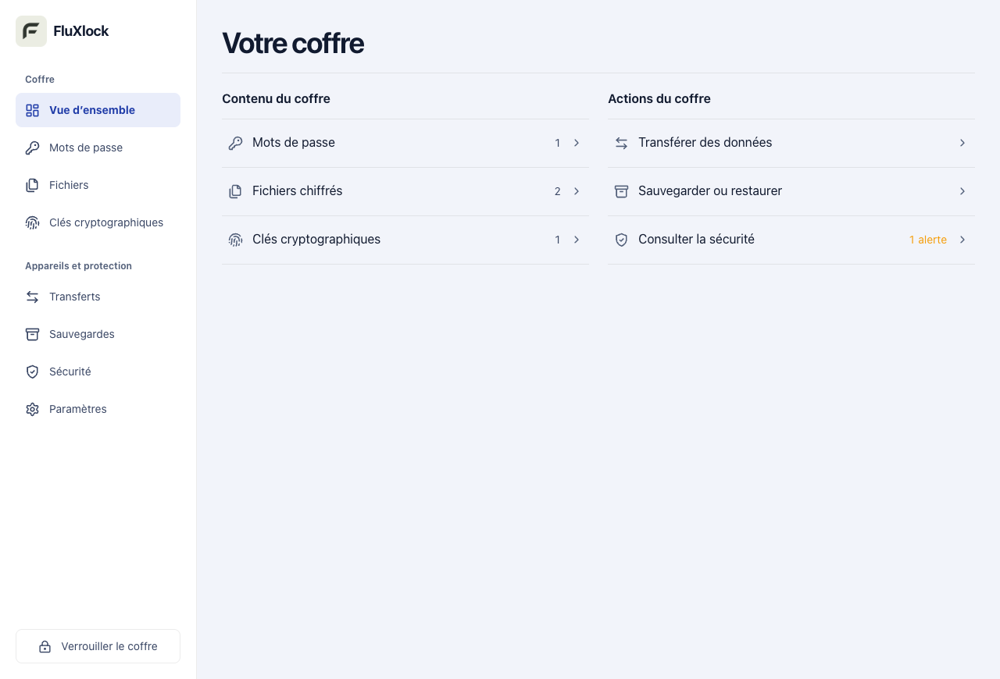

<p align="center">
  
</p>

<h1 align="center">FluXlock</h1>

<p align="center">
  Un coffre local pour vos mots de passe, vos fichiers et vos clés cryptographiques.
</p>

<p align="center">
  <a href="https://github.com/Tiemtore-dev/fluxlock-releases/releases/latest"><strong>Télécharger FluXlock</strong></a>
  · <a href="docs/USER_GUIDE.md">Guide utilisateur</a>
  · <a href="CHANGELOG.md">Notes de version</a>
</p>

FluXlock fonctionne sur **macOS, Windows, Linux et Android**. Vous déverrouillez votre coffre avec un mot de passe maître. Les données sont chiffrées sur l’appareil. Pour passer d’un appareil à l’autre, vous pouvez restaurer une sauvegarde ou lancer un transfert chiffré sur votre réseau local.

<p align="center">
  
</p>

## Installation

Choisissez l’installeur correspondant à votre appareil dans les fichiers de la [dernière version officielle](https://github.com/Tiemtore-dev/fluxlock-releases/releases/latest).

| Plateforme | Fichier à choisir |
| --- | --- |
| macOS Apple Silicon | `*_aarch64.dmg` |
| macOS Intel | `*_x64.dmg` |
| Windows 64 bits | `*_x64-setup.exe` ou `*_x64_en-US.msi` |
| Linux 64 bits | `*_amd64.deb`, `*.x86_64.rpm` ou `*_amd64.AppImage` |
| Android 7 ou ultérieur | `*_android.apk` pour ARM64 et ARMv7 |

Les paquets « FluXlock Test » de GitHub Actions utilisent un profil de coffre distinct. Pour ouvrir votre coffre habituel, utilisez l’installeur de la version officielle.

### Premier démarrage

1. Créez votre coffre local, choisissez son nom et définissez un mot de passe maître d’au moins 12 caractères. Conservez ce mot de passe en lieu sûr. Il est nécessaire pour ouvrir une sauvegarde.
2. Ajoutez un mot de passe ou ouvrez **Mots de passe → Importer un CSV**. Vous pouvez examiner les entrées et choisir le traitement des doublons avant de confirmer.
3. Créez une archive chiffrée depuis **Sauvegardes** et conservez-la sur un autre support.

Vous pouvez créer plusieurs coffres, chacun avec ses propres données et son mot de passe maître. Un seul coffre peut être déverrouillé à la fois. Le bouton **Changer de coffre** verrouille le coffre ouvert et permet d’en sélectionner un autre. Le nom se modifie dans **Paramètres**.

Si vous avez déjà un coffre sur cet appareil, installez la version officielle par-dessus la précédente et déverrouillez-le avec votre mot de passe maître. Pour restaurer sur un autre appareil, créez le coffre de destination, puis ouvrez **Sauvegardes**. La restauration remplace uniquement le contenu du coffre sélectionné, conserve son nom et demande les mots de passe du coffre actuel et de la sauvegarde. [Guide de sauvegarde et de restauration](docs/USER_GUIDE.md#sauvegarde-et-restauration)

## Dans le coffre

| Fonction | Ce que vous pouvez faire |
| --- | --- |
| **Mots de passe** | Enregistrer, rechercher et générer des mots de passe. Importer des exports CSV de Brave, Chrome, Firefox, Apple, Bitwarden, 1Password, LastPass ou FluXlock. |
| **Fichiers** | Chiffrer des fichiers en conservant l’original à son emplacement. Exporter une copie déchiffrée vers la destination choisie. |
| **Notes** | Enregistrer un titre et un texte chiffrés, joindre un fichier ou rattacher un fichier du coffre, rechercher par titre et transférer une note avec sa pièce jointe. |
| **Clés** | Générer, importer et conserver des clés cryptographiques, dont des clés Ed25519, X25519, ML-KEM-768 et ML-DSA-65. |
| **Transferts** | Choisir les éléments à envoyer à un autre appareil sur le réseau local et confirmer la connexion par un code. La version 2.3 requiert une mise à jour des deux appareils pour les transferts et l’appairage. |
| **Sauvegardes** | Archiver la base du coffre et les fichiers protégés. Restaurer l’archive sur un appareil compatible. |
| **Biométrie** | Activer le déverrouillage avec Windows Hello, Touch ID ou un capteur Android lorsque l’appareil et la signature de l’application le permettent. Le mot de passe maître reste utilisable. |

Les CSV exportés contiennent des mots de passe en clair. Les fichiers transitant par le sélecteur Android ou par le transfert local sont limités à **32 Mio par fichier**. Les transferts se lancent depuis l’application et l’appairage sert à échanger le registre de confiance.

## Sécurité et compatibilité

- **Coffre local.** Argon2id dérive une clé à partir du mot de passe maître. Les nouveaux enregistrements utilisent le chiffrement authentifié ChaCha20-Poly1305.
- **Fichiers.** Le format SENC v2 dérive une clé par fichier via HKDF-SHA-256 et chiffre les blocs avec ChaCha20-Poly1305. FluXlock peut lire les fichiers déjà chiffrés au format SENC v1.
- **Transferts.** Le code temporaire participe à l’établissement de la session via SPAKE2. ML-KEM-768 contribue à la clé de session et ChaCha20-Poly1305 protège les messages.
- **Sauvegardes.** FluXlock vérifie l’intégrité des archives avant de remplacer le coffre de destination. Les anciens fichiers compagnons sont pris en charge dans les archives authentifiées.

## Développement

L’extension d’autofill Chromium et son relais natif sont disponibles dans les sources, avec authentification dans l’application et sélection du seul compte du site exact. Ils nécessitent l’application construite depuis ces sources et une installation locale explicite ; ils ne sont pas publiés dans un store. Voir [la construction et l’installation](browser-extension/README.md) et [les vérifications de sécurité](docs/implementation/browser-extension-verification.md).

Le canal d’extension **v2** combine **ML-KEM-768 et X25519**, avec authentification **ML-DSA-65**. La migration exige la mise à jour des trois composants et un nouvel appairage ; aucun repli classique. [Profil cryptographique, migration et vérifications](docs/implementation/autofill-post-quantum-v2.md).

Le dépôt contient l’interface React et TypeScript, l’application native Tauri et le noyau cryptographique Rust. Référez-vous aux [prérequis Tauri](https://v2.tauri.app/start/prerequisites/) pour installer les dépendances de votre plateforme.

Depuis la racine du dépôt, lancez l’application de bureau en développement avec Node.js et Rust stable installés.

```sh
cd tauri-desktop
npm ci
npm run tauri -- dev
```

Compilez l’interface et exécutez les tests applicatifs depuis `tauri-desktop`.

```sh
npm run build
cargo test --locked --manifest-path src-tauri/Cargo.toml
```

Exécutez les tests du noyau cryptographique depuis la racine du dépôt.

```sh
cargo test --locked --manifest-path rust-crypto-core/Cargo.toml
```

| Dossier | Contenu |
| --- | --- |
| [`tauri-desktop/src`](tauri-desktop/src) | Interface et parcours utilisateur |
| [`tauri-desktop/src-tauri`](tauri-desktop/src-tauri) | Application native et projet Android |
| [`rust-crypto-core`](rust-crypto-core) | Primitives et formats cryptographiques |
| [`.github/workflows`](.github/workflows) | Validation multiplateforme et publication |

## Licence

FluXlock est conçu par [Tiemtore Fahim](https://github.com/Tiemtore-dev) et distribué sous [licence MIT](LICENSE).
