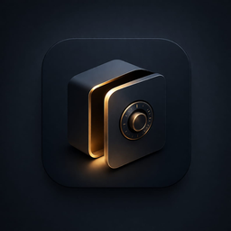
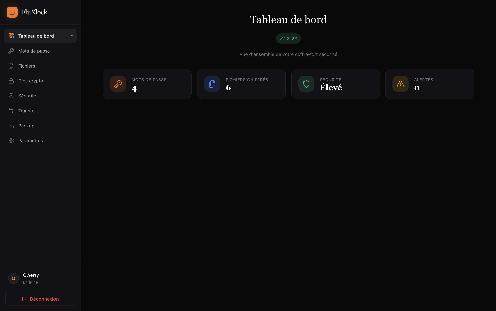

# FluXlock

**Coffre-fort numérique de nouvelle génération**

Gérez vos mots de passe, chiffrez vos fichiers et transférez vos données en toute sécurité — même face aux futures menaces quantiques.

 

[Fonctionnalités](#-fonctionnalités) · [Aperçu](#-aperçu) · [Téléchargement](#-téléchargement) · [Sécurité](#-sécurité)

 

## 📸 Aperçu

Tableau de bord FluXlock — Vue d'ensemble de votre coffre-fort

 

## ✨ Fonctionnalités

### 🔐 Gestion des mots de passe
Stockez, organisez et générez des mots de passe forts en un clic. Chaque mot de passe est chiffré individuellement avant d'être enregistré. Un indicateur de force vous aide à choisir des mots de passe solides.

### 📁 Coffre-fort de fichiers
Chiffrez n'importe quel fichier, quelle que soit sa taille. Le chiffrement s'effectue par flux (streaming), ce qui permet de traiter même les fichiers volumineux sans surcharger la mémoire.

### 🔑 Clés cryptographiques
Générez et gérez des paires de clés de chiffrement — aussi bien classiques (Ed25519, X25519) que post-quantiques (ML-KEM-768, ML-DSA-65).

### 🔄 Transfert pair-à-pair
Transférez votre coffre-fort vers un autre appareil sur le même réseau local, sans passer par un serveur distant. La connexion s'établit par un simple code, et les données sont re-chiffrées à la volée.

### 🛡️ Détection de ransomware
FluXlock surveille votre système de fichiers en temps réel. Si un comportement suspect est détecté (chiffrement massif, extensions douteuses), votre coffre-fort bascule automatiquement en lecture seule.

### 📱 Biométrie
Déverrouillez votre coffre-fort avec Touch ID (macOS), Windows Hello ou le capteur biométrique de votre téléphone Android. Le mot de passe maître reste toujours requis au premier démarrage.

### 📋 Journal d'audit signé
Chaque action sensible est enregistrée dans un journal inviolable. Les entrées sont signées numériquement et liées entre elles — toute altération est immédiatement détectable.

### 💾 Backup & Restauration
Sauvegardez l'intégralité de votre coffre-fort dans un fichier chiffré. Restaurez-le en un clic sur n'importe quel appareil.

 

## 🏗️ Construit avec

| Couche | Technologies |
|:---:|:---|
| **Frontend** | React 18 · TypeScript · TailwindCSS · Zustand · React Query · Vite 5 |
| **Backend** | Rust · Tauri v2 · SQLite (WAL) · Tokio |
| **Cryptographie** | ChaCha20-Poly1305 · Argon2id · ML-KEM-768 · ML-DSA-65 · BLAKE3 · SHA3 |
| **Plateformes** | macOS · Windows · Linux · Android |

 

## 🖥️ Plateformes supportées

| Plateforme | Version minimum | Biométrie |
|:---|:---|:---|
| 🍎 **macOS** | Big Sur (11+) | Touch ID |
| 🪟 **Windows** | Windows 10+ | Windows Hello |
| 🐧 **Linux** | glibc 2.31+ | — |
| 🤖 **Android** | API 24+ | TEE / StrongBox |

 

## 📥 Téléchargement

Téléchargez la dernière version de FluXlock directement depuis la page des releases :

### **[⬇️ Télécharger FluXlock]([https://github.com/Tiemtore-dev/fluxlock/releases/latest](https://github.com/Tiemtore-dev/fluxlock-releases/releases))**

Formats disponibles :

| Plateforme | Format |
|:---|:---|
| macOS | `.dmg` |
| Windows | `.exe` (installeur) |
| Linux | `.deb` · `.rpm` · `.AppImage` |
| Android | `.apk` |

> Les mises à jour sont automatiques une fois l'application installée.

 

## 🔒 Sécurité

FluXlock est conçu pour protéger vos données aujourd'hui **et** demain.

### Protection post-quantique

Les ordinateurs quantiques menaceront un jour les algorithmes de chiffrement classiques. FluXlock intègre dès maintenant les standards post-quantiques du NIST :
- **ML-KEM-768** (FIPS 203) pour l'échange de clés
- **ML-DSA-65** (FIPS 204) pour les signatures numériques

### Chiffrement de bout en bout

Vos données ne sont jamais stockées en clair. Le mot de passe maître est dérivé via **Argon2id** (résistant aux attaques GPU), puis utilisé pour chiffrer chaque élément avec **ChaCha20-Poly1305**.

### Zéro confiance, zéro trace

- Les clés sont effacées de la mémoire dès qu'elles ne sont plus utilisées
- La mémoire sensible est verrouillée pour ne jamais être paginée sur le disque
- Les comparaisons de secrets s'effectuent en temps constant
- Pas de serveur central — vos données restent sur votre appareil

### Défense active

- **Anti-brute-force** : délai exponentiel entre les tentatives, verrouillage du compte après trop d'échecs
- **Anti-ransomware** : surveillance de 50+ extensions suspectes, bascule automatique en lecture seule
- **Anti-traversée de chemin** : validation stricte de tous les chemins de fichiers

 

## 📚 Guide utilisateur

Pour apprendre à utiliser FluXlock en détail, consultez le **[Guide utilisateur](docs/USER_GUIDE.md)** — installation, premiers pas, et mode d'emploi de chaque fonctionnalité.

 

## 🗺️ Roadmap

- [x] Gestion des mots de passe avec chiffrement ChaCha20-Poly1305
- [x] Coffre-fort de fichiers (chiffrement streaming)
- [x] Transfert P2P chiffré (SPAKE2 + ML-KEM hybride)
- [x] Biométrie (Touch ID, Windows Hello, Android TEE)
- [x] Détection de ransomware en temps réel
- [x] Journal d'audit signé (ML-DSA-65)
- [x] Backup & restauration chiffrés
- [x] Mise à jour automatique signée
- [ ] Authentification à deux facteurs (TOTP)
- [ ] Partage de fichiers chiffré avec révocation

 

## 📄 Licence

Distribué sous licence **MIT** — voir le fichier [LICENSE](LICENSE) pour plus de détails.

 

---

**FluXlock** — Sécurité redéfinie.

Conçu par [Tiemtore Fahim](https://github.com/Tiemtore-dev)

